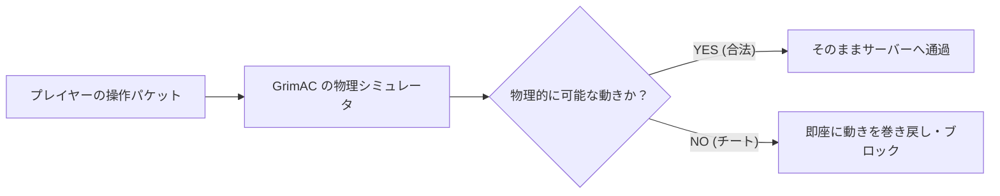

# Grim Anticheat 

**Grim Anticheat (GrimAC)** は、Minecraft（Spigot / Paper / Purpur / Folia 等）サーバー向けに完全無料でオープンソース開発されている次世代のチート対策プラグインです。  
従来のアンチチートとは異なり、サーバー側で**Minecraftの物理演算エンジン・移動予測・遅延（レイテンシ）をリアルタイムに完全再現**してパケットを検証します。これにより、Fly、Speed、NoSlow、Timer、Reach などの強力なチートを確実に無効化・ブロックしつつ、通常プレイヤーやラグのあるプレイヤーに対する「誤検知（False Positive）」を極限まで排除しています。

:::warning

編集時点での情報を元にしています。
今後のバージョンアップで仕様変更が行われる可能性があります。

:::

## 基本情報

| 項目 | 内容 |
| :--- | :--- |
| **開発者** | GrimAnticheat Team (MWHunter, firmac ほか) |
| **対応バージョン** | 1.8.8 〜 26.3（各バージョンおよびマルチスレッドサーバー Folia にネイティブ対応） |
| **前提プラグイン** | なし（ProtocolLib や PacketEvents などの外部ライブラリ不要） |
| **ダウンロード** | [GitHub Releases (公式)](https://github.com/GrimAnticheat/Grim/releases) / [Hangar](https://hangar.papermc.io/GrimAnticheat/Grim) / [Modrinth](https://modrinth.com/plugin/grimac) |

---

## GrimAC が圧倒的に支持される理由



1. **完全物理シミュレーション（1:1 Prediction Engine）**  
   プレイヤーが受けているノックバック、足元のブロック摩擦（氷やソウルサンド）、水流、ポーション効果、エリトラ飛行などをサーバー側で完璧に計算して照合します。
2. **パケットレベルの相殺・セットバック**  
   チートを使った移動（例: 水上歩行や空中浮遊）を検知すると、即座に直前の合法的な位置へと引き戻す（Setback）ため、サーバーへの被害を未然に防ぎます。
3. **外部ライブラリ不要の超軽量設計**  
   独自の内蔵パケットハンドラを持っているため、前提プラグインを必要とせず、Folia などの次世代サーバー基盤でも高いパフォーマンスを発揮します。

---

## 導入手順

1. **サーバーを停止する**  
   コンソールで `stop` を実行し、サーバーを完全に停止します。

2. **jar ファイルをダウンロードする**  
   [GitHub Releases](https://github.com/GrimAnticheat/Grim/releases) から最新の `Grim-x.x.x.jar` をダウンロードします。

3. **plugins フォルダへ配置する**  
   ダウンロードした `.jar` ファイルをサーバーの `plugins/` フォルダに入れます。

4. **サーバーを起動する**  
   サーバーを起動すると、`plugins/GrimAC/` ディレクトリと設定ファイル（`config.yml`）が自動生成されます。

5. **導入確認**  
   ゲーム内またはコンソールで `/grim` を実行し、ヘルプ画面が表示されれば正常に起動しています。

----

## 主なコマンド一覧

:::tip 
`/grimanticheat` コマンドは、すべて短縮形の **`/grim`** または **`/grimac`** で実行できます。
:::

| コマンド | 説明 |
| :--- | :--- |
| `/grim alerts` | 不正検知アラート通知の受信 ON/OFF を切り替えます。 |
| `/grim profile <プレイヤー名>` | 指定プレイヤーの Ping、パケットロス、シミュレーション追跡状態を詳細表示します。 |
| `/grim spectate <プレイヤー名>` | 対象プレイヤーの周囲を観戦し、挙動を監視します。 |
| `/grim verbose` | デバッグ用の詳細な検証ログをチャット欄にリアルタイム表示します。 |
| `/grim reload` | 設定ファイル（`config.yml`）を再読み込みします。 |
| `/grim help` | 利用可能な Grim コマンド一覧を表示します。 |

----

## 権限ノード (Permissions)

通常は管理者やモデレーターグループに付与します。一般プレイヤーには付与しないでください。

```yaml title="LuckPerms 権限付与例" showLineNumbers {1,5-7,10}
# 管理者向け（全コマンド操作・リロード）
grim.admin

# モデレーター・警備スタッフ向け（アラート受信・監視）
grim.alerts
grim.profile
grim.spectate

# 【注意】チート検知を完全に免除するバイパス権限（管理者テスト用）
grim.bypass
```

----

## config.yml の日本語訳・おすすめ設定

設定ファイル（`plugins/GrimAC/config.yml`）内の重要項目です。編集後は `/grim reload` で反映されます。

```yaml title="plugins/GrimAC/config.yml" showLineNumbers {3,8-11,18-20,26-28}
# ----------------------------------------------------
# 1. 自動処罰（Punishment）コマンドの設定
# ----------------------------------------------------
# 違反レベル（VL）が一定値に達した際に自動実行するコマンド
# [player] は違反者、[check] は検知されたチート名に置換されます
punishments:
  enabled: true
  commands:
    # 違反スコアが 20 を超えたら自動 Kick
    20: "kick [player] &c[GrimAC] 不正な挙動が検出されました。"
    # 違反スコアが 50 を超えたら自動 BAN（LiteBans などのコマンドも指定可能）
    50: "ban [player] 7d &c[GrimAC] 不正ツールの使用が検出されました。"

# ----------------------------------------------------
# 2. Discord Webhook 連携（チート検知の通知）
# ----------------------------------------------------
# Discord のテキストチャンネルにチート検知ログを送信できます
discord:
  enabled: true
  webhook-url: "https://discord.com/api/webhooks/XXXXXXXX/XXXXXXXXXXXX"
  send-alerts: true

# ----------------------------------------------------
# 3. アラートの表示スタイル
# ----------------------------------------------------
# ゲーム内で OP / モデレーターに表示されるアラートの形式
alerts:
  format: "&c[GrimAC] &e[player] &7が &f[check] &7でフラグされました &8(VL: [vl])"
  click-command: "/tp [player]" # アラートをクリックした時の動作（テレポート）
```

----

## よくある質問・トラブルシューティング (FAQ)

### Q1. エリトラやトライデントで飛んでいるプレイヤーが誤検知されませんか？
**回答**: 心配ありません。GrimAC は 1.8 〜 最新バージョンの全アイテムの物理ベクトル（加速・重力・抵抗）を完全に計算しているため、エリトラ飛行や激流トライデント、ロケット花火による加速でも誤検知による引き戻しは基本的に発生しません。

### Q2. プレイヤーの Ping（回線遅延）が高い時に誤判定されませんか？
**回答**: GrimAC はプレイヤーの過去のパケット到着時刻と Ping を遡ってシミュレーションする「クライアント側タイムライン補正」を搭載しています。一時的なラグスパイク（Ping 300〜500ms程度）が発生しても、チート判定されることはありません。

### Q3. キルオーラ（KillAura）や自動クリッカー（AutoClicker）は検知できますか？
**回答**:
- **Reach（射程距離拡大）や HitBox（当たり判定拡大）**: GrimAC の最も得意とする分野であり、100%確実に検知・ブロックされます。
- **CPS（連打速度）やエイムアシスト**: GrimAC は主に「物理・移動・当たり判定」に特化しているため、異常なクリック連打対策をより強化したい場合は、補助としてクリック専門の検知プラグインを併用することも有効です。