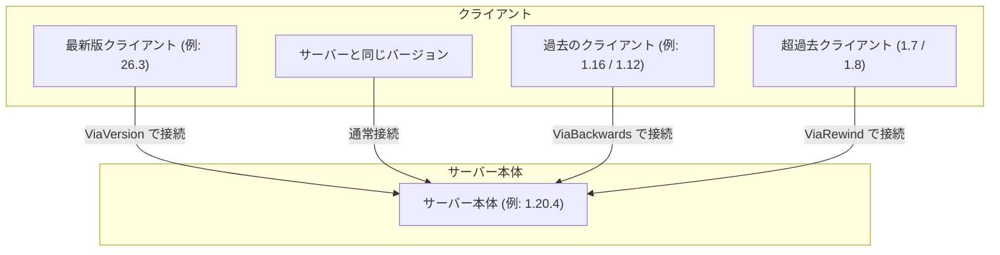

# ViaVersion 

**ViaVersion** は、Minecraft（Spigot / Paper / Purpur / Velocity / BungeeCord 等）サーバーにおいて、**サーバー本体のバージョンよりも新しいクライアント**からの接続を可能にするプロトコル変換プラグインです。  
例えば、導入プラグインの安定性を優先してサーバー本体を「1.20.4」で運用している場合でも、最新の「26.3」で起動したプレイヤーがそのままサーバーに参加してマルチプレイを楽しむことができます。

:::warning

編集時点での情報を元にしています。
今後のバージョンアップで仕様変更が行われる可能性があります。

:::

## 基本情報

| 項目 | 内容 |
| :--- | :--- |
| **開発者** | FlorianMichael (ViaVersion Team) |
| **対応バージョン** | サーバー本体 1.8.8 〜 26.3（各バージョンおよび主要プロキシに対応） |
| **前提プラグイン** | なし |
| **ダウンロード** | [Hangar (PaperMC 公式)](https://hangar.papermc.io/ViaVersion/ViaVersion) / [Modrinth](https://modrinth.com/plugin/viaversion) / [SpigotMC](https://www.spigotmc.org/resources/viaversion.19254/) |

---

## ViaFamily（関連プラグイン）の役割と違い

ViaVersion は「古いサーバーに新しいクライアントを繋ぐ」ためのプラグインです。逆方向やより古いバージョンに対応させたい場合は、姉妹プラグインを併用します。



| プラグイン名 | 役割 | 接続できるクライアント |
| :--- | :--- | :--- |
| **ViaVersion**（本作） | 古いサーバーに「新しい」クライアントを繋げる | サーバー版 〜 **最新版 (26.3)** |
| **ViaBackwards** | 新しいサーバーに「古い」クライアントを繋げる | **1.9** 〜 サーバー版 |
| **ViaRewind** | 1.8 以前のレガシークライアントを繋げる | **1.7.x / 1.8.x** |

---

## 導入手順

1. **サーバーを停止する**  
   コンソールで `stop` を実行し、サーバーを完全に停止します。

2. **jar ファイルをダウンロードする**  
   [Hangar](https://hangar.papermc.io/ViaVersion/ViaVersion) または [Modrinth](https://modrinth.com/plugin/viaversion) から最新の `ViaVersion-x.x.x.jar` をダウンロードします。

3. **plugins フォルダへ配置する**  
   ダウンロードした `.jar` ファイルをサーバーの `plugins/` フォルダに入れます。  
   ※ Velocity や BungeeCord などのプロキシサーバーを使用している場合は、**プロキシ側の `plugins/` フォルダにのみ配置**することを推奨します。

4. **サーバーを起動する**  
   サーバーを起動すると、`plugins/ViaVersion/` ディレクトリと設定ファイル（`config.yml`）が自動生成されます。

5. **導入確認**  
   サーバーコンソールまたはゲーム内で `/viaversion list` を実行し、エラーなくコマンドが認識されていれば導入完了です。

----

## 主なコマンド一覧

:::tip 
`/viaversion` コマンドは、すべて短縮形の **`/viaver`** で実行できます。
:::

| コマンド | 説明 |
| :--- | :--- |
| `/viaversion list` | 現在サーバーに接続しているプレイヤーのクライアントバージョン一覧を表示します。 |
| `/viaversion dump` | バグ報告やトラブルシューティング用の診断データURLを発行します。 |
| `/viaversion reload` | 設定ファイル（`config.yml`）を再読み込みします。 |
| `/viaversion dontbugme` | 管理者向けの新バージョン更新通知を非表示にします。 |

----

## 権限ノード (Permissions)

通常は一般プレイヤーには付与せず、管理者（OP）のみに付与します。

```yaml title="LuckPerms 権限付与例" showLineNumbers {1,4}
# 管理者向け（全コマンド操作）
viaversion.admin

# 新バージョンのリリース通知を受け取る権限
viaversion.update
```

----

## config.yml の日本語訳・おすすめ設定

設定ファイル（`plugins/ViaVersion/config.yml`）内の重要項目です。

```yaml title="plugins/ViaVersion/config.yml" showLineNumbers {3,8,13,18}
# ----------------------------------------------------
# 1. 特定バージョンの接続をブロックする
# ----------------------------------------------------
# 許可したくないバージョンプロトコル番号をリストに指定します（空なら全許可）
block-versions: []

# ----------------------------------------------------
# 2. クライアント側の攻撃速度クールダウン表示
# ----------------------------------------------------
# 1.8 サーバーに 1.9 以降のクライアントが繋いだ際、剣のゲージ表示を隠すか
suppress-1_9-action-bar-cooldown: true

# ----------------------------------------------------
# 3. ホログラムの高さ微調整
# ----------------------------------------------------
# バージョン間の視点差によるホログラム表示のズレを自動補正します
hologram-patch: true

# ----------------------------------------------------
# 4. チャット署名の警告抑止
# ----------------------------------------------------
# 1.19 以降のセキュアチャットプロファイルに関連するエラーや切断を緩和
enforce-secure-chat: false
```

----

## 仕組みと注意点：新しいブロックやアイテムはどう見える？

ViaVersion はクライアントとサーバーの間でやり取りされる「パケット」をリアルタイムで翻訳・変換しています。

:::info 
新要素のエミュレーションの仕組み

- **サーバーに存在しない新しいアイテム**:  
  古いサーバー本体には新アイテムのデータが存在しないため、ViaVersion によって自動的に「見た目が似ている既存アイテム」や「設定された代替アイテム」として安全にダウングレード変換されて処理されます。
- **地形の完全な互換性**:  
  ワールドの地形データ自体はサーバー本体のバージョン基準で生成・管理されるため、ワールドデータが壊れる心配はありません。
:::

----

## よくある質問・トラブルシューティング (FAQ)

### Q1. 新しいクライアントで入ると「サーバーと互換性がない」と弾かれます
**原因**: ViaVersion が最新の Minecraft バージョンに対応していない可能性があります。  
**解決策**: Minecraft 本体のアップデート直後は、ViaVersion 側も対応アップデートが必要です。[Hangar](https://hangar.papermc.io/ViaVersion/ViaVersion) から最新ビルドをダウンロードして差し替えてください。

### Q2. サーバー（Paper/Spigot）とプロキシ（Velocity/BungeeCord）のどちらに入れるべきですか？
**推奨**: Velocity や BungeeCord を使ったネットワーク構成の場合、**プロキシサーバー側**に導入するのが最も効率的で安定します。各サブサーバー側への個別導入は基本的に不要です。

### Q3. 逆に「最新のサーバーに、古いクライアント（1.16 や 1.12）」を接続させたいです
**解決策**: 本プラグイン（ViaVersion）に加えて、姉妹プラグインである **[ViaBackwards](https://hangar.papermc.io/ViaVersion/ViaBackwards)** を同じ `plugins/` フォルダに導入してください。